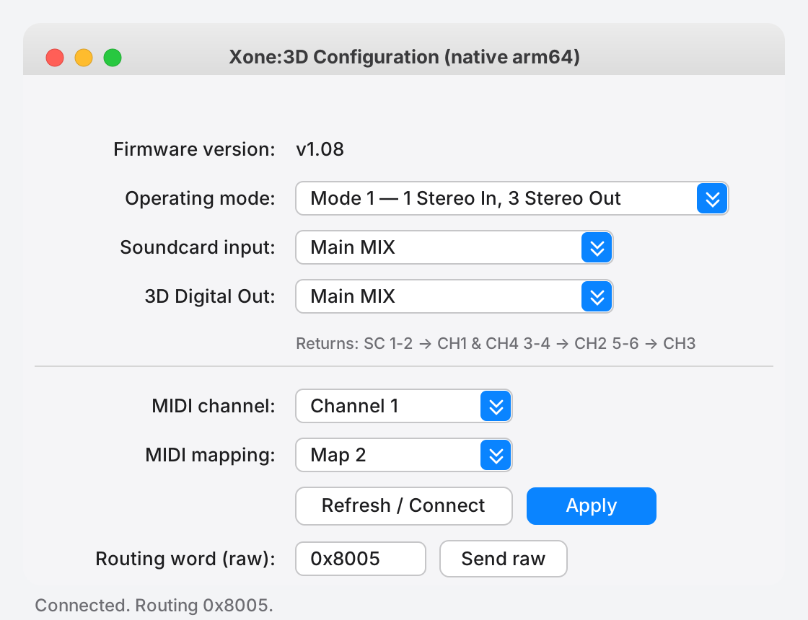

# Xone:3D Configuration (native Apple Silicon)

[](https://buymeacoffee.com/digitui)

A native **arm64 macOS** replacement for the long-dead Ploytec *Xone3D.app*
configuration utility for the **Allen&nbsp;&&nbsp;Heath Xone:3D** DJ mixer /
USB soundcard.

The original utility was a 2006 **PowerPC + 32-bit Intel** binary. It cannot
launch on an Apple Silicon Mac at all — Rosetta&nbsp;2 only translates x86_64,
and 32-bit support was removed from macOS in Catalina (2019). This project
reimplements the utility from scratch against the device's USB protocol (which
was recovered by reverse engineering), so it runs natively on M1/M2/M3.



> The panel mirrors the **Soundcard Operating Modes** section of the Xone:3D
> User Guide — Mode 1 / Mode 2, the soundcard input and 3D digital-out sources,
> and the MIDI channel / mapping settings.

---

This is an **unofficial** tool that configures the soundcard and MIDI settings
of the Allen&nbsp;&&nbsp;Heath Xone:3D on current macOS. It is **not made,
endorsed or supported by Allen&nbsp;&&nbsp;Heath or Ploytec.**

## ⚠️ Caution

This software talks directly to your Xone:3D over USB and changes how the mixer
is configured. **You use it entirely at your own risk**, and there is no warranty
of any kind.

It is an unofficial, reverse-engineered tool, and the routing-word layout behind
the menus is a **reconstruction**. An unexpected value could leave the soundcard
in an unusable state until it is set back. Before changing anything, note your
device's original routing word and keep it (use `Send raw` / the CLI to restore
it), and change one setting at a time.

**Firmware flashing is deliberately not included** in this tool, because a
botched flash can **permanently brick** the Xone:3D — a failure at the wrong
moment could leave the mixer needing an EEPROM programmer to repair, and
Allen&nbsp;&&nbsp;Heath almost certainly won't support a unit modified this way.
The firmware opcodes are documented in [`docs/`](docs/) for reference only; do
not drive them without a verified image, a recovery path, and full acceptance of
that risk.

Only go ahead if you accept these risks.

---

## Features
- Reads the firmware/version string from the mixer.
- Full **Soundcard Operating Modes** panel:
  - **Mode 1** — 1 Stereo In / 3 Stereo Out (default)
  - **Mode 2** — 2 Stereo In / 2 Stereo Out
  - input source menus (incl. SPDIF in), 3D digital-out source, and a live
    "returns" summary; the layout changes with the mode just like the original.
- MIDI channel (1–16) and MIDI mapping (Map&nbsp;1 / Map&nbsp;2).
- A raw routing-word field for exact control and verification.
- A companion command-line tool (`tools/xone3d.py`) for scripting.

Firmware **flashing is deliberately not included** (it can brick the unit, and
the record framing was not verifiable without hardware). Read-only firmware dump
is available in the CLI tool.

## Requirements
- An Apple Silicon (or Intel) Mac running macOS 11+.
- Xcode command-line tools: `xcode-select --install`
- libusb: `brew install libusb`

## Build & run (the app)
```bash
cd app
./build.sh            # or: swift build -c release --build-system native
open ./Xone3D.app
```
`build.sh` compiles a release arm64 binary, assembles `Xone3D.app`, and ad-hoc
code-signs it. If Gatekeeper blocks it the first time: right-click → **Open**, or
`xattr -dr com.apple.quarantine ./Xone3D.app`.

You can also open it in Xcode: `cd app && open Package.swift`.

## Command-line tool
```bash
brew install libusb && python3 -m pip install pyusb
python3 tools/xone3d.py info
python3 tools/xone3d.py get-routing
python3 tools/xone3d.py set-routing 0x8005
```

## The one gotcha on modern macOS
If macOS has bound the Xone:3D as a USB-audio device, a user-space libusb open
can return **"Access denied"** and the app/tool will say so. Try it before the
audio driver claims the device, temporarily remove that binding, or open an issue
and the USB layer can be re-pointed at Apple's `IOUSBHost` API so it coexists
with audio. The six control transfers are identical either way.

## How it works / the protocol
Everything is a single USB vendor control transfer on endpoint 0
(`wValue=0x0100`, `wIndex=0x0001`):

| Operation | bRequest | bmRequestType | Dir | wLength |
|-----------|:--------:|:-------------:|:---:|:-------:|
| getVersion    | `0x00` | `0xC2` | IN  | 16 |
| readRouting   | `0x01` | `0xC2` | IN  | 2  |
| sendRouting   | `0x02` | `0x42` | OUT | 2  |
| startFirmware | `0x05` | `0x42` | OUT | 0  |
| readFirmware  | `0x06` | `0xC2` | IN  | n  |
| writeFirmware | `0x07` | `0x42` | OUT | n  |

Device: VID `0x0A4A` (Ploytec) / PID `0xFF00`. Full write-up and the routing-word
bit layout are in [`docs/REVERSE_ENGINEERING_REPORT.md`](docs/REVERSE_ENGINEERING_REPORT.md)
and [`docs/protocol.json`](docs/protocol.json).

## Project layout
```
app/      native Swift/AppKit arm64 application (SwiftPM) + build.sh
tools/    xone3d.py — libusb/pyusb command-line equivalent
docs/     reverse-engineering report, protocol spec, screenshot
```

## Support
If this helped you configure your Xone3D, you can [buy me a coffee](https://buymeacoffee.com/digitui). Thank you!

## Disclaimer
This is an independent, interoperability-focused reimplementation created from
clean-room reverse engineering of the USB protocol. It is **not affiliated with,
endorsed by, or supported by Allen&nbsp;&&nbsp;Heath or Ploytec**. "Xone" and
"Allen&nbsp;&&nbsp;Heath" are trademarks of their respective owners. It ships no
part of the original application. Use at your own risk; configuration changes and
any firmware operation are your responsibility.

## License
MIT — see [LICENSE](LICENSE).
